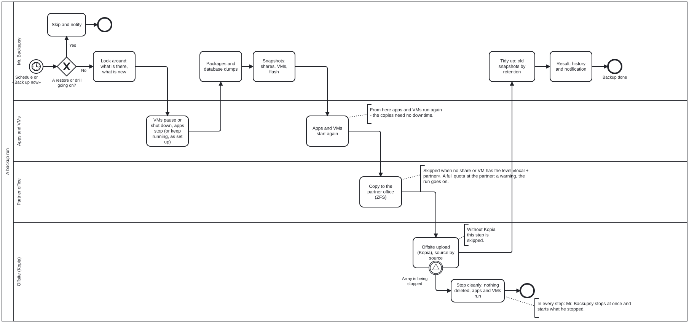
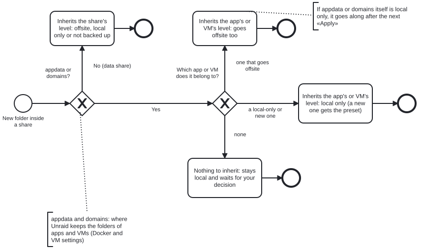
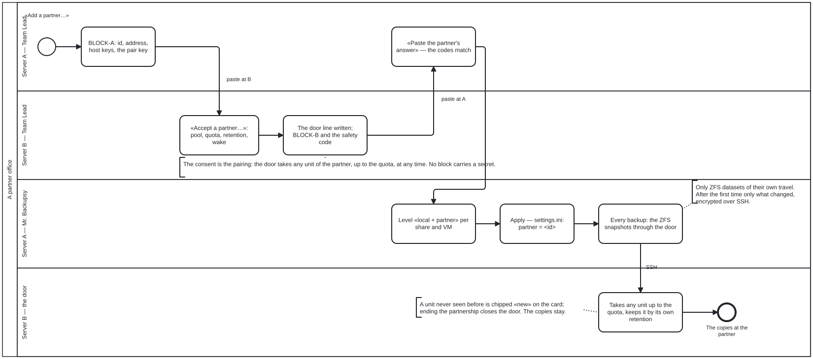

# Unraid Secretary Office — the full guide

What each desk does, what happens end to end, and where the office keeps what. The short version is the
[README](../README.md).

<a name="reception-team"><picture><source media="(prefers-color-scheme: dark)" srcset="https://raw.githubusercontent.com/dropnook/UnraidSecretaryOffice/main/docs/screenshots/reception-dark.png"></picture></a>

## The staff

| | Desk | What they do for you |
|---|---|---|
| 👥 | **The Team Lead** | Suggests whom to hire for your server and tells you what is left to do — *still to do*, *recommended*, *good to know* — each with a link into Unraid. Pairs partner offices — over a network you have or the office's own USO network (Tailscale) — and hands a gone server's copies to a new one. |
| 💾 | **Mr. Backupsy** | Sets up and runs the backup on your schedule: snapshots, database dumps, a package per app and VM, optional encrypted offsite copies with Kopia and copies at a partner office — per share, app and VM: off, local, local + partner, local + offsite, local + partner + offsite. Shows what a run is doing, how the last runs went and how each share, app and VM is really protected — by what the runs made, not by the settings. |
| 📦 | **Mr. Restori** | Brings back databases, folders, whole shares, single files, templates and VM configurations — from the packages, the local snapshots, the offsite copy (Kopia) or a partner office. Shows where the flash's archive is kept and downloads it. Puts aside what he replaces, never deletes it, and can undo every restore. Practises restores on his own: the restore drill. |
| 📸 | **Ms. Snapshotini** | Every ZFS, btrfs and VM snapshot on the server: create, delete with an estimate of the space freed, rename, hold. Schedules with a simple retention that only ever clears away her own. The entries a deleted VM leaves in Unraid's snapshot list — Unraid's VM page can't remove them — she takes out once nothing of them is left on disk (into the storeroom; put back any time). |
| 🏮 | **The Night Watchman** | Says how securely the server stands, and keeps a watch book of what is different from normal — logins, containers, plugins, the flash, schedules, data flow, vanished snapshots, and what your router reports. Changes nothing himself. |
| 🧹 | **Ms. Dustdevil** | Knows where everything lies and gives advice on keeping it in order. Clears away what nobody uses — templates, stacks, appdata folders, Docker's leftovers — into a storeroom first, never deleting at once (Docker's volumes are copied in before Docker removes them; only images and the build cache, which can be downloaded again, and volumes mounted from elsewhere go for good). Gives containers without a picture a logo. |
| 📝 | **Ms. Protocolli** | Reads every log out loud — Unraid's, the office's, every User Script's and container's, the router's. Her tour counts and groups the errors and warnings and watches how full `/var/log` is. Unraid's syslog she also sorts by the rules from Enhanced Log (disks, network, file systems, array, logins …): her tile *Syslog* counts the lines per kind and lists the newest of each, a chip per kind shows only those; harmless noise counts neither as an error nor as a warning, and the reader colours the syslog the same way (each line with its kind's edge). Without a recent tour she sorts the syslog's newest lines at once. Every list has its filter bar with a time filter (the last hour, today, since the server started, or from … to …); lists sort by time or by service (emhttpd, sshd, kernel …), and a click on a line's service shows only that one; what a bar has set can be saved under a name — kept on the server, applied only when you click it. On *Set up* you add rules of your own (they come first) and texts to hide in her view. Her tile *Who woke my disks?* (only with spinning disks) notices every wake of an array or pool HDD — Unraid logs only the spin-down — and who was caught waiting for it while it spun up: a container, a VM, a computer over SMB or NFS, the mover, a scheduled task, the office or a program, with its open files; per disk how often today and in 7 days. She only watches and never wakes a disk. Her tile */var/log* watches Unraid's small RAM disk for logs every minute: from 80 % she says which file fills it, which lines it writes most and — when the server knocks on its own web UI, as Netdata's nginx collector does — which program or container is behind it; at 90 % she sends one notification. |
| 🍿 | **Jack Streamer** | The intern. Looks after helmi1987's MediaCache for Emby, Jellyfin and Plex — several servers at once (what you watch next waits on the fast pool, the array disks sleep; watched files go back the way Unraid's mover moves them — by the share's settings) and, optionally, the media gather (one disk per film folder, so fewer disks wake when files go back and forth; on request it also fetches the folders' files from the cache — never what MediaCache keeps there). Never gathers while someone watches. While MediaCache runs for real, a bar per person shows what is coming for them, how far it is and when their last file will be there (MediaCache copies everyone's files in one queue), finished parts how long they took; *Stop after this file* ends the run gently — the next run goes on. Shows how much of each library lies on which disk or pool, with the date it was measured. His *Set up* tab takes a budget in GB — the hard cap for everything he lays out, at least 20 GB per person; the counts per person are defaults inside it. Being an intern, he works only under Ms. Moverelli's supervision: he can be hired only together with her or after her (and she leaves only after him). Runs for real only once she is set up and keeps MediaCache's list out of her moves, with Unraid's own mover schedule *Disabled* — until then dry runs only. *Move now* by hand stays possible: the mover starting during a run stops it after the current file. While Mover Tuning moves on a schedule of its own, his real runs wait. |
| 🚚 | **Ms. Moverelli** | Completes Unraid's mover with helmi1987's Smart Mover: one limit X for the pool (on ZFS the whole pool counts): above X she moves the oldest files of the other cache shares (the younger of added and changed counts) to the array or a secondary pool until the pool sits at X — Jack Streamer's GB come first, appdata & co. never move, episodes not yet watched never go back and forth, and she warns when the room is short. Leaves out what exclude lists name and hands the files to Unraid's own move program; she copies nothing herself. The joint run (on her schedule or started by hand): measure, make room, measure again, then Jack Streamer fetches up to X — her page draws it live (the pool before, the forecast after, the array, files on their slow way) and keeps the last run's picture. Shows Unraid's mover schedule, what moves where share by share and what the last run moved and left. List, dry run and real run from her page or on her own schedule. When you save her setup she switches Unraid's own mover schedule off (she asks first: «Unraid's own mover will be switched off — I move from now on»), through Unraid's own form; letting her go puts it back as it was. Mover Tuning must have no schedule of its own; User Scripts and cron lines that call a mover are named, never changed. Never runs beside Unraid's mover, one of Jack Streamer's runs or a backup run's local part. A missing exclude list on a real run skips that share; MediaCache's list before its first run holds her real runs back until then (said once). Her log names the sleeping array disks a run wakes. Takes over the settings of an existing Smart Mover install. Supervises Jack Streamer. Unraid 7.3.2 and newer. |
| 💼 | **The Consultant** | Knows the tools the office relies on — Kopia, Fix Common Problems, Files Viewer, Stream Viewer, unbalanced, Node Exporter, Prometheus, Grafana — and installs them with you, a preview first. Sets up the Kopia repository if you like and prints a recovery sheet; shows how the router's log reaches Unraid (UniFi, MikroTik). |

A fresh office has only the Team Lead. He looks at your server and suggests whom to hire (no Emby, Jellyfin or Plex, no Jack Streamer; no
ZFS or btrfs, no Ms. Snapshotini). Jack Streamer comes only with Ms. Moverelli — *Hire together with Ms. Moverelli*. Hire whom you need, let them go later — their data and settings stay; Mr. Restori
asks to come together with Mr. Backupsy, and *Hire together with Mr. Backupsy* hires both. Mr. Backupsy's *Let
go* offers «Also clear away what he kept here»: his packages go to Ms. Dustdevil's storeroom and his own local
snapshots are deleted — his settings and the offsite copies (in your storage and at the partners) stay. Letting Jack Streamer go switches off his
two schedules (a run that is going finishes); «Also bring what I laid out from my libraries back to the array» moves what he
laid out on the pool back, the way its cleanup does (never while someone watches); Unraid's mover schedule stays off —
Ms. Moverelli still moves, and letting her go (after him) switches it back on as it was. Hired
again, his settings are as they were and the schedules stay off until you switch them on. *Change the order* at the
reception puts the desks in the order you like.


<a name="jack-live"><picture><source media="(prefers-color-scheme: dark)" srcset="https://raw.githubusercontent.com/dropnook/UnraidSecretaryOffice/main/docs/screenshots/jack-live-dark.png"></picture></a>

<a name="moverelli-live"><picture><source media="(prefers-color-scheme: dark)" srcset="https://raw.githubusercontent.com/dropnook/UnraidSecretaryOffice/main/docs/screenshots/moverelli-live-dark.png"></picture></a>

<a name="snapshot-why"><picture><source media="(prefers-color-scheme: dark)" srcset="https://raw.githubusercontent.com/dropnook/UnraidSecretaryOffice/main/docs/screenshots/snapshot-dark.png"></picture></a>

## What happens, end to end

### The scheduled backup

At the time you chose under Mr. Backupsy's *Schedule…*, the backup engine starts on the server — the office needn't be
open. It never shares a minute with Ms. Moverelli's run: whoever starts first goes first, the other waits (her run only until the backup's local part is done). VMs you set to shut down go down first; Nextcloud goes into maintenance mode; the apps that write into backed-up
shares stop briefly while their databases are dumped. Each app and VM gets a fresh **package** in the backup place
(templates or compose files, the dumps, the VM's configuration). The VMs you chose are frozen or paused for a few
seconds while ZFS and btrfs **snapshots** freeze the shares, the packages and the VMs' disks; then everything starts
again. Next the snapshots of what you ticked go to your **partner office**, then the **offsite** copy: Kopia uploads
from the snapshots, encrypted, to your storage (S3, Backblaze B2, SFTP, WebDAV, a NAS …) — the flash first, then the
apps, then the shares and VMs, the smallest first. Old snapshots go by your retention. A new folder simply goes with its share — offsite when
the share goes offsite; only in appdata and domains (the shares Unraid keeps apps and VMs in) it follows the app or VM it
belongs to (offsite with an offsite app, local with a local one). Something new — an app, a VM, a folder there of no
app or VM or of a new one — stays local and keeps running until you decide in the setup; a new share waits for the setup too. A failed run, or one with warnings, lands in Unraid's notifications. *Stop the run* ends a run
cleanly, and its card says what it still waits for (apps stopping, a VM, the offsite upload); stopping the array ends
it cleanly too, and what it had stopped comes back right after the array starts.

The whole run at a glance ([BPMN source](diagrams/backup-run.bpmn), [German](diagrams/backup-run.de.svg)):

<a name="diagram-backup-run"></a>

What a new folder inherits ([BPMN source](diagrams/new-folder.bpmn), [German](diagrams/new-folder.de.svg)):

<a name="diagram-new-folder"></a>

A partner office, from the pairing to the copies — and the receiver starting from them ([BPMN source](diagrams/partner-pairing.bpmn), [German](diagrams/partner-pairing.de.svg)):

<a name="diagram-partner-pairing"></a>

<a name="backup-run"><picture><source media="(prefers-color-scheme: dark)" srcset="https://raw.githubusercontent.com/dropnook/UnraidSecretaryOffice/main/docs/screenshots/backup-dark.png"></picture></a>

### Getting something back

Mr. Restori lists every app, VM and share with what can come back from where, with dates: its package, the local
snapshots of its folders, the offsite copy (Kopia), a partner office. A share no app uses comes back whole (what is there
goes aside first) or folder by folder; *Files in it…* browses any moment — a local snapshot, what came back from Kopia
or a partner, a copy kept for a partner — and brings back single files and folders at any depth, next to what is there,
swapped in or into a restore folder; from Kopia you browse a snapshot and bring back a single file or folder instead of
the whole source; the packages Kopia keeps (database dumps, templates, VM configurations) are earlier backups like the
local ones. Choose a database, a folder, a share, the templates or a VM's configuration, and he shows exactly what will
happen — the steps, which containers stop and for how long, what goes
aside where. Only when you confirm does he start, on the server, one restore at a time and never during a backup.
«Restored» lists every restore with its steps and what went aside where; *Put back* undoes one, also one that failed.
He never starts or recreates a container — he says what to click. For the rest there are ready-made commands with your
names and paths, and a guide *onto a new server*.

**The flash** has a tile of its own: when its archive was made, how big it is and where it is kept — here, offsite, at a
partner (or the boot pool's snapshots, or «not backed up»). *Download…* hands you the archive after a dialog that says
what it holds (the licence key, the password hashes); single files from it you copy back by hand. **Kept for
<partner>** shows what this server keeps of a partner office, with the apps and VMs inside each copy — each can be
started here.

### The restore drill

Once a month or every week on the day you choose (between 00:00 and 07:00, right after a backup that went well),
or whenever you press *Practise now…*, Mr. Restori proves that what Mr. Backupsy keeps really comes back. He reads every package in full,
plays the database dumps into throwaway containers without network, checks the media servers' database copies and the
VMs' disks, and streams a sample back from the offsite copy (as many GB as you allow) to compare with the local
snapshot — where an app's package goes offsite, one of its dumps is read back from there and played too. Each app and
VM gets a **certificate**: which level is proven, from which copy, when; a step that failed shows its error. The drill
wakes no disk, never runs during a parity check, ends well before the next backup and cleans up after itself (what an
interrupted one left, Ms. Dustdevil clears away). What it left unchecked comes first the next time.

<a name="restore-drill"><picture><source media="(prefers-color-scheme: dark)" srcset="https://raw.githubusercontent.com/dropnook/UnraidSecretaryOffice/main/docs/screenshots/restore-drill-dark.png"></picture></a>

### The Night Watchman's round

When you hire him he learns what is normal (his *On watch since* tile says until when). From then on he walks his
round every five minutes, office open or not, and writes down only what is different: a login from an address he
hasn't seen, a burst of failed logins, a container that got special rights, a new plugin, a change on the flash, a new
cron line, a share newly open to guests, a client or container sending far more than usual, far more written to a
share or disk than usual or many files deleted at once (ZFS per share, XFS and btrfs per disk — btrfs keeps no count of
deleted files, only the space they free), snapshots gone that nobody in the office removed. Each entry names its MITRE ATT&CK technique; the important ones go to Unraid's notifications.
*I know, thanks* makes it the new normal. While the array is stopped — also while an encrypted array waits for its key
— his night shift keeps watch from RAM and the flash.

**The router** (UniFi gateways and MikroTik routers with RouterOS 7): it sends its log to Unraid's own syslog
server — the Consultant shows both sides, for a MikroTik the lines to paste — and he reads it on his round: router and
VPN logins not seen before, firewall, NAT or port-forwarding changes, intrusion detections at this server, a new device
on the LAN or one using the server's name or address, the router's log gone silent. A MikroTik also tells him of bursts
of failed router logins, a port losing its link again and again, the internet away (a short outage is a plain line, a
long one is told once it is over) and a restart without proper shutdown — at the same time as the server's own start,
a power loss for both. No router password, never a word to the router; other devices only as new ones, the rest are
counts.

**Why a parity check runs:** each one gets a plain line with its reason — on schedule, resumed by Parity Check Tuning,
by hand (when that plugin saw it), a disk rebuild (no check at all), or after an unclean stop: the array didn't stop
within the *Shutdown time-out* at the last shutdown (what held it up — a busy disk, a VM switched off hard — as far as
Unraid's diagnostics or its kept syslog show), or the server went off without shutting down. Unraid then checks the
parity at every start until a stop is clean again; he says so once, and the Team Lead lists which time-out to raise
(Docker + VMs + a margin) until a later stop is clean. He never starts, pauses or cancels a check.

**What holds the array?** Before you stop the array or shut down, his tile says what would hold it up right now: a
shell in an SSH session or the web terminal sitting in a share, a User Script, a plugin's script or a cron job with a
file open there, an ISO mounted from the array — each with what to do. Then whom Unraid waits for: each running VM and
whether its guest agent answers (a Windows VM without one often ignores the first request and takes the whole *VM
shutdown time-out*), each container with the time it gets (Unraid's own all get its *Docker Stop Timeout*, a database
asking for more is killed earlier); what stops by itself (the office's own work, Unraid's mover, SMB clients, Unraid's
local syslog server writing into a share); and whether the *Shutdown time-out* is long enough for all of it. He looks
when his page opens and on *Check now* — read only, no disk wakes up, nothing is stopped.

<a name="watchman-book"><picture><source media="(prefers-color-scheme: dark)" srcset="https://raw.githubusercontent.com/dropnook/UnraidSecretaryOffice/main/docs/screenshots/watchman-dark.png"></picture></a>

### The search

The magnifier at the top right, or ⌘K / Ctrl+K inside the office, finds a desk, a section, a tile, a setting, a step
of a setup or one of the Consultant's guides — in all five languages at once, forgiving a typo. It also finds what the
desks know right now: a share, an app, a VM, a database, an open point, an entry of the watch book, a partner office,
what Ms. Dustdevil would clear away and where it lies. Choose one and the office takes you there, opens it and marks
the place. It all runs in your browser.

## Install and first steps

Unraid **7.3.2 or a newer 7.x**; Unraid 8 is not supported yet, the plugin refuses to install there. Snapshots need
pools or array disks on ZFS or btrfs (shares on XFS are backed up without one); partner offices need ZFS. Before you
update Unraid itself, look for an office release that names the new version — Unraid switches off a plugin that
doesn't at its first boot, and the scheduled backups stop with it; the Team Lead reminds you once your Unraid is newer
than the one the office was tested on.

1. *Plugins → Install Plugin* and paste
   ```
   https://github.com/dropnook/UnraidSecretaryOffice/releases/latest/download/unraid-secretary-office.plg
   ```
2. Open **Sekretariat** in Unraid's menu bar. The Team Lead welcomes you and suggests whom to hire. The office keeps
   its data in the share *appdata*; Docker (and so Kopia) needs the share *system*. Unraid creates both only once
   Docker is turned on: on a server without them the office first lists what is missing and why, and offers to create
   them — the messenger then adds them the way Unraid's *Shares* page does (only on the pool *cache* when there is one,
   else on the array) and moves in within seconds. *domains* and *isos* (VMs) are only mentioned. A share that was
   there and is gone is never created anew. Nothing happens without that click; you can also create the shares
   yourself. Is only *system* missing later, the Team Lead offers the same.
3. For backups: Mr. Backupsy → *Set up…* — first the backup place, a share of its own for his packages: one click has
   Unraid create `UnraidSecretaryOffice` where he proposes (you see exactly what before), or create one yourself, or
   choose one that's there; then the rest (he reads the server and proposes everything with reasons; change what you
   like — the bar counts his proposals and your changes, *Leave out* declines one of his — then *Apply*), then
   *Schedule…*. The Team Lead lists what is still missing.

*⋯ → Entry in Unraid* renames the menu entry or moves it under *Settings → User Utilities* or to a button in Unraid's
header. A tile on Unraid's Dashboard shows the essentials: the messenger, the Team Lead's open points, the last and
next backup. The green dot beside *⋯* means the messenger (the office's agent) checked in within the last 70 seconds.

<a name="backup-apply"><picture><source media="(prefers-color-scheme: dark)" srcset="https://raw.githubusercontent.com/dropnook/UnraidSecretaryOffice/main/docs/screenshots/backup-setup-dark.png"></picture></a>

## Updates and removal

**Updating** works like any plugin, under *Plugins*; the Team Lead also says when a new version is out. While a
backup, a restore or drill, one of Jack Streamer's runs or one of Ms. Moverelli's is going on, the update refuses — try again when it is done. The
new version is unpacked and checked beside the running one; your data stays and is brought up to date at the first
start, what is rewritten put aside. A page left open offers to reload; a recommendation you put aside with «I know,
thanks» comes back once when an update changes what it says.

**Removing** (*Plugins → Remove*, refused like an update while such a run is going on) takes the code away and lets
go of what the office had mounted. Your schedules are put aside on the flash and come back when you install the office
again. Partnerships with other offices end — pair again after a new install. Your data in appdata, the share
`UnraidSecretaryOffice`, the settings on the flash, your snapshots and Ms. Dustdevil's storeroom (the hidden folders
`.UnraidSecretaryOffice-trash`) stay; delete them yourself if you don't want them
any more.

## What it keeps where

| What | Where |
|---|---|
| Settings, state and logs of every desk, the backup engine's settings | the data folder, `appdata/UnraidSecretaryOffice/data` |
| Mr. Backupsy's packages (templates, compose files, dumps, VM configurations) | the backup place: a share of its own, by default `UnraidSecretaryOffice` (the setup's first step: created on your click by Unraid's own «Add Share» where he proposes, made by you in Unraid, or a share you choose) — their history in its snapshots |
| The plugin package, where the data folder is, the schedules, partner keys, uploaded container pictures | the flash, `/boot/config/plugins/unraid-secretary-office/` |
| The code, the messenger's sign of life, the snapshots mounted during a run, the numbers for Prometheus | RAM — nothing of the office lands on the pool every few seconds, so a pool of hard disks can sleep |

Nothing leaves the server unless you set it up: the offsite copy (Kopia) to the storage you chose, partner offices to
the partner. The office itself only asks GitHub once a day whether a new version is out, checks logo addresses for
containers without a picture, and sends a report only when you send one yourself (below) — and, when you open the list
of your reports, asks where they stand. No telemetry. The desks never wake a sleeping disk unless you ask;
the scheduled backup does, unless you tell it to leave sleeping pools out.

<a name="cleanup-where"><picture><source media="(prefers-color-scheme: dark)" srcset="https://raw.githubusercontent.com/dropnook/UnraidSecretaryOffice/main/docs/screenshots/cleanup-where-dark.png"></picture></a>

## Languages and themes

The office speaks English, German, Italian, French and Spanish — your browser's language, English where it doesn't
speak yours; *⋯ → Language* picks another one. Where it tells you what to click in Unraid, Unraid's menus read as
Unraid shows them, in the language Unraid runs in. It takes Unraid's theme; *Auto · Dark · Light* at the reception
gives the office's own area the look of Unraid's black or white theme, and a text-size switch *A · A · A* beside it
makes it larger — both in your browser only.

## Security

- The office is part of Unraid's web UI: only who is logged in to Unraid gets in, and every change carries Unraid's
  CSRF token. Whoever is logged in to Unraid is root anyway, so there is no PIN of its own — keep Unraid logged in only
  on devices you trust. What the office adds are previews and confirmations against mistakes.
- The page only shows. The messenger does the work on the host — only the actions the desks define, each checked
  against a fresh look at the server, commands without a shell.
- What is tidied up or replaced is put aside first, never deleted at once: Ms. Dustdevil's storeroom, Mr. Restori's
  things put aside.
- Secrets stay put: Kopia's keys reach Kopia through RAM only, the media servers' API keys never reach the page, the dumps name
  password variables, never their values.
- A partner office gets a door, not a login: a key that can only hand over its copies, fetch them back and ask how
  the office is — no shell, no path, nothing deleted.
- Bringing something back from a partner's copy trusts that partner like your own backup: what comes back is what the
  partner kept. Mr. Restori checks a VM's configuration from a copy (nothing of this server outside the VM's own folder,
  no passed-through devices) and starts nothing — look at templates and stacks from a copy before you start them.
- The office's data folder and the folder above it belong to root: whoever else could write there could put a folder of
  their own in its place. The Team Lead says so when it isn't, with the command to fix it; the backup engine refuses to
  run from a folder that isn't root's alone.

What was checked and what is still open: [HARDENING.md](../HARDENING.md).

<a name="cleanup-storeroom"><picture><source media="(prefers-color-scheme: dark)" srcset="https://raw.githubusercontent.com/dropnook/UnraidSecretaryOffice/main/docs/screenshots/storeroom-dark.png"></picture></a>

## Partner offices

Two Unraid servers with the office — yours, a family member's, a friend's — can keep each other's backups. Paired at
the Team Lead (two blocks to paste, one safety code to compare; the receiver sets its rules once: the pool, a quota, its
retention), the level **local + partner** per share and VM in Mr. Backupsy's setup says what goes: with every backup
their ZFS snapshots go to the partner — after the first one only what changed — through SSH; the partner's door takes
any of them up to the quota, keeps them with its own retention, and you can never delete them there. Over a slow or
lossy internet path several shares go at once, but only while that really makes the copy faster; a rate limit counts
for all of them together. What the partner really received is what Mr. Backupsy shows as «+ partner»; Mr. Restori's
*At <partner>* brings it back into a new dataset beside the original.
When a server is gone, the new one asks at its Team Lead (*Start from a partner's copy…*) and the partner answers with
a **restore ticket** — a door for seven days that only hands over those copies; Mr. Restori's *Onto a new server*
pulls the backup place first, then the shares and VMs. ZFS only, and the partner can read the copies — for a friend,
Kopia is the encrypted way.

**The USO network (Tailscale), optional.** Two servers behind different routers (or behind CGNAT) need a network that
reaches both. Any you already have works — your LAN, your VPN, your own Tailscale. Or the Team Lead joins this server to
a tailnet of the offices' own: *Join the USO network…* under the partner offices takes an auth key that whoever runs the
tailnet made (one-off, tagged `tag:uso`; Tailscale's free plan for home use, or your own Headscale). The office then
runs a Tailscale node of its own — its own device in its own network namespace, its own door for partners, a helper
fetched from the office's GitHub release and checked against the fingerprint in this version. Nothing of your router,
your own Tailscale, Unraid's network, DNS or firewall changes. Then pair as always: in the network both sides give
their USO address by themselves (another only on purpose, under *Another address…*), and a block that brought a LAN
address is said, with the partner's USO address offered instead. A pair that stored the wrong address — or a partner
that joined anew with a new one — is fixed without pairing anew: *Change the address…* in the pair's ⋯ menu (the card
offers it when the partner is online in the network elsewhere) looks for the partner there first, then stores it; the
partner does the same on its side, and Mr. Backupsy's next run sends there. The card
shows the node, the other offices in the network (online, direct or relayed) and the lines for the tailnet's policy;
the Team Lead says when the node isn't tagged, when other devices can reach it, or when it has no contact. *Leave the
USO network…* (and the plugin's removal) takes everything of it away again.

<a name="backup-levels"><picture><source media="(prefers-color-scheme: dark)" srcset="https://raw.githubusercontent.com/dropnook/UnraidSecretaryOffice/main/docs/screenshots/levels-dark.png"></picture></a>

<a name="caretaker-partner"><picture><source media="(prefers-color-scheme: dark)" srcset="https://raw.githubusercontent.com/dropnook/UnraidSecretaryOffice/main/docs/screenshots/partner-dark.png"></picture></a>

## Notifications

What needs you while the office is closed goes to Unraid's notifications (the bell, and mail or push if you set them up
under *Settings → Notifications*), as *Unraid Secretary Office*: a backup run that failed or had warnings, a drill
that couldn't prove a restore, a schedule's problem, a new point on the Team Lead's list after half an hour, the
Night Watchman's new entries (each kind at most once an hour) and a parity check after an unclean stop, the messenger silent
for ten minutes. The desks write
in the language you last used the office in; the backup engine writes English.

**The Team Lead's notification centre** is the one place for all of it — for the office's own notifications only: Unraid's
(array, SMART, updates, parity) and other plugins' stay exactly as they are, and Unraid's notification settings are only read. Alerts — something at risk right now — always go out at
once; nothing there stops them. Per colleague you choose how much goes out (*Everything* · *Warnings and alerts* ·
*Alerts only*), successes too or not (Mr. Backupsy, Jack Streamer), and *right away* or *in the summary at* a time
of day — colleagues on the same time share one summary; an empty one is never sent. *Quiet hours* and *Silent until…*
hold everything but alerts and send it as one summary when they end; an optional daily sign of life says «All quiet»
when nothing went out for a day. A flood guard always holds: the same notification goes out once until it is resolved
(a run that ends well, the messenger back) or a day later — never an alert: each alert goes, also the same one again,
and only the very same alert (the same words) twice within a minute goes once; more than 5 from one colleague or 20 from the whole office
in an hour are collected for a summary, with one notice; past 10 alerts an hour the rest go as one alert every 15
minutes. *Send a test notification…* shows where Unraid sends each level. Two more tiles beside it: what waits for the
summary (and how it would read) and the history of 30 days — sent, collected, counted, not sent; every list has its
filter bar, and each rule has a tip on hover.

## Monitoring

With a Node Exporter, Prometheus and Grafana on the server (the Consultant sets them up with you), the office's own
numbers go there too, with a ready Grafana dashboard: [DEVELOPMENT.md](DEVELOPMENT.md#monitoring). For
developers — how it works inside, adding a desk or a language, tests and releases — the same document.

## Support

The office is free and complete — nothing is locked, now or later. If it is useful to you, a tip is welcome: the tip
jar in the office (the Team Lead's *☕ Tips & pay rise*) opens the [tip page](https://tip.uso.dropnook.app/) (PayPal)
with your anonymous USO ID; after the tip the office fetches your supporter key by itself (the page shows it too, to paste
under *Enter key…*). A share goes to helmi1987 (see below). The key unlocks nothing — it stops the reminders and shows a
thank-you on the Team Lead's plate, which only you see, a little office story: ☕ one coffee for the team (any amount),
☕☕ a round for everyone (from 20), 🍰 a cake for the whole office (from 50), 🥂 the whole team toasting a pay rise and
the donations (from 100; USD, EUR or CHF). Every key is kept; each picture shows once — never a count. If the tips ever exceed what our work costs, we give the
rest to animal shelters that urgently need financial support. Questions and bugs:
[GitHub issues](https://github.com/dropnook/UnraidSecretaryOffice/issues), or without an account from inside the office
(below).

## Reporting a problem or a wish

No GitHub account needed: *⋯ → Report a problem or a wish…* on any page (or the button at the Team Lead's *The team*).
Say what it is — a problem, a wish or a question — which desk it is about, a title and a few words. *Show what will be
sent…* then lists everything that would go, part by part: your words as you typed them, the office's and Unraid's
versions, the languages, which desks you hired, the desk's last error, and its last lines from the messenger's log —
cleaned of share, pool, server, partner and user names, paths, addresses, MAC addresses, e-mail addresses and keys
(you see what was hidden). Untick what you'd rather keep. Up to three pictures can go along — the office redraws them,
without location or other metadata. Nothing leaves the server before you click *Send*.

It goes to the office's makers, into a private inbox on GitHub — not public; the makers, GitHub and Cloudflare (who
carries it) can read it. Each office can send 25 reports a day, and *Your reports* keeps the list: where each one
stands — received, looked at, done — and, once the makers opened a public GitHub issue for it, a link to it
(«Issue #…»). For that the office asks the inbox when you open the dialog (each report at most once an hour), with
nothing but the reports' numbers in the inbox and the office's report ID.

<a name="office-report"><picture><source media="(prefers-color-scheme: dark)" srcset="https://raw.githubusercontent.com/dropnook/UnraidSecretaryOffice/main/docs/screenshots/report-dark.png"></picture></a>

Thanks to **[helmi1987](https://github.com/helmi1987)** for Jack Streamer's MediaCache and folder consolidation and
for Ms. Moverelli's Smart Mover, and to **dlandon** and **Derek Kaser (EDACerton)** for the syslog rules of Ms. Protocolli
from Enhanced Log — see the [README](../README.md#special-thanks).
