# Unraid Secretary Office — the full guide

What each desk does for you, what happens end to end, and where the office keeps what.
The short version is the [README](../README.md).

<a name="reception-team"><picture><source media="(prefers-color-scheme: dark)" srcset="https://raw.githubusercontent.com/dropnook/UnraidSecretaryOffice/main/docs/screenshots/reception-dark.png">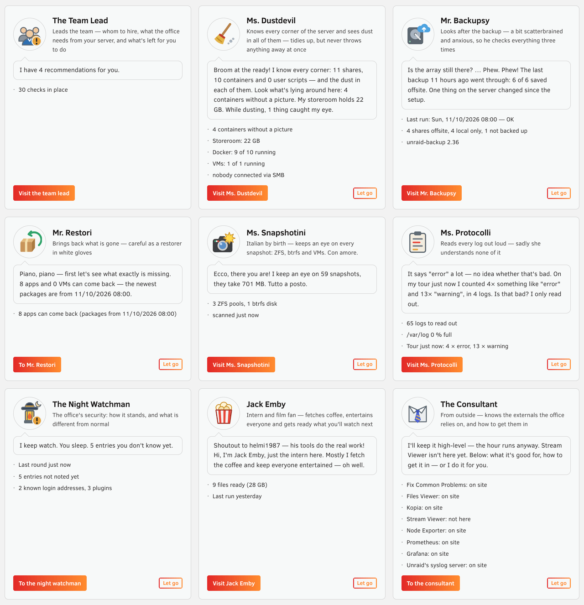</picture></a>

## The staff

Each desk is one person with one job. Hire only the ones your server needs.

| | Desk | What they do for you |
|---|---|---|
| 💾 | **Mr. Backupsy** | Backs up shares, apps and VMs on your schedule: locally, to a partner office, offsite with Kopia. |
| 📦 | **Mr. Restori** | Brings back databases, folders, shares, files, templates and VMs, and proves it with a drill. |
| 🍿 | **Jack Streamer** | Puts on the fast pool what each person watches next (Emby, Jellyfin, Plex), so the array disks sleep. |
| 🚚 | **Ms. Moverelli** | Keeps the pool at one limit: moves the oldest files to the array, leaves alone what should stay. |
| 👥 | **The Team Lead** | Suggests whom to hire, lists what is left to do, pairs partner offices. |
| 📸 | **Ms. Snapshotini** | Every ZFS, btrfs and VM snapshot: create, delete, rename, hold, schedules with a retention. |
| 🏮 | **The Night Watchman** | Says how securely the server stands and writes down what is different from normal. |
| 🧹 | **Ms. Dustdevil** | Shows how full everything is and clears away what nobody uses, into a storeroom first. |
| 📝 | **Ms. Protocolli** | Reads every log, counts errors and warnings, says who woke your disks. |
| 💼 | **The Consultant** | Installs the tools the office relies on with you, a preview first. |

**Hiring and letting go:**

- A fresh office has only the Team Lead. He looks at your server and suggests whom to hire.
- Jack Streamer comes only with Ms. Moverelli. Mr. Restori asks to come with Mr. Backupsy.
- Letting a desk go keeps its data and settings. Hired again, its schedules stay off until you switch them on.
- Mr. Backupsy's *Let go* can also clear away his packages (into the storeroom) and his local snapshots.
- Letting Jack Streamer go can bring what he laid out back to the array.

Every desk that works on its own has a tile *Schedule*: the next run, the schedule in words, how the last run ended.

## What happens, end to end

### The scheduled backup

At the time you chose, the backup runs on the server. The office needn't be open.

The steps, as Mr. Backupsy's page shows them:

1. **Look around:** what is there, what is new.
2. **Database dumps:** VMs set to shut down go down. Nextcloud goes into maintenance mode.
   The apps that write into backed-up shares stop, and their databases are dumped and checked.
   Each app and VM gets a fresh **package** in the backup place: templates or compose files, dumps, VM configuration.
3. **Snapshots:** VMs set to freeze or pause are held for a few seconds.
   ZFS and btrfs **snapshots** freeze the shares, the packages and the VMs' disks. Then everything starts again.
4. **Partners:** the snapshots of what you chose go to your **partner office**. After the first time, only what changed.
5. **Offsite:** Kopia uploads from the snapshots, encrypted, to your storage (S3, Backblaze B2, SFTP, WebDAV, a NAS …).
   The flash first, then the apps, then the shares and VMs, the smallest first.
6. **Tidy up:** old snapshots go by your retention. A failed run, or one with warnings, lands in Unraid's notifications.

**Who goes first.** The engine does one run at a time:

- The scheduled backup and Ms. Moverelli's run never share a minute. Whoever starts first goes first.
- When her run is going, the scheduled backup waits until it is done.
- When the backup is going, her scheduled run waits until steps 1 to 3 are done.
  When the backup reads a share she moves without a snapshot, she waits for the whole backup.
- Started by hand, neither waits: the start is refused while the other runs.
- A restore, a drill, the setup or an earlier run still going: the scheduled backup is skipped and says why.

**Something new** stays local until you decide:

- A new folder in a data share goes with its share. A new folder in appdata or domains follows its app or VM.
- A new app, VM or share, or a folder of none, stays local and waits in the setup, marked «new».
- A new container keeps running during the run; a new VM is not held.

**Stopping.** *Stop the run* ends a run cleanly. Its card says what it still waits for.
Stopping the array ends it cleanly too. What it stopped comes back right after the array starts.

**Retention at a glance.** Three places keep your backups for a while:

- Local snapshots: days, weeks, months — for all, or per share or VM. btrfs keeps whole days.
- Offsite (Kopia): latest, hourly, daily, weekly, monthly, yearly — for all, or per share, app and VM.
- A partner office: by its own rule, set on its side when you paired.

Mr. Backupsy's tile *Retention* shows what is kept where, per share, VM, app and the flash.

The whole run at a glance ([BPMN source](diagrams/backup-run.bpmn), [German](diagrams/backup-run.de.svg)):

<a name="diagram-backup-run">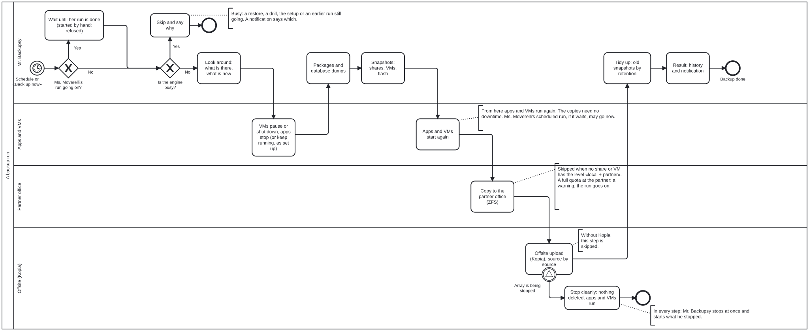</a>

What a new folder inherits ([BPMN source](diagrams/new-folder.bpmn), [German](diagrams/new-folder.de.svg)):

<a name="diagram-new-folder">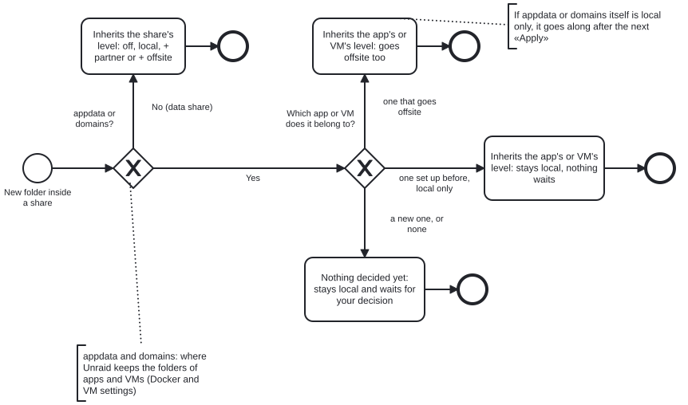</a>

<a name="backup-run"><picture><source media="(prefers-color-scheme: dark)" srcset="https://raw.githubusercontent.com/dropnook/UnraidSecretaryOffice/main/docs/screenshots/backup-dark.png">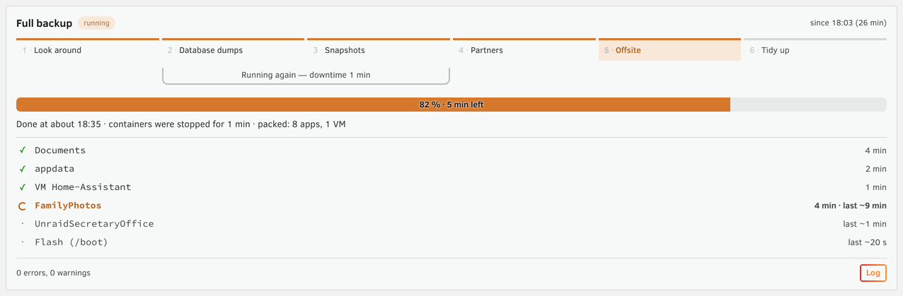</picture></a>

### Getting something back

Mr. Restori lists every app, VM and share with what can come back from where, with dates.
The sources: its package, the local snapshots, the offsite copy (Kopia), a partner office.

- **A database, the templates, a VM's configuration:** he first shows exactly what will happen, step by step.
- **A share** no app uses comes back whole (what is there goes aside first) or folder by folder.
- **Single files and folders:** *Files in it…* browses a local snapshot, a Kopia snapshot or a partner's copy.
  What you pick comes back next to what is there, swapped in, or into a restore folder.
- **From a partner:** a row pulls the copy that holds it. A pulled whole share can be *swapped in* as the share.
- **All VM definitions:** *Everything back into libvirt.img*, once the VM service is off. The old image stays aside.

How he works:

- He starts only when you confirm. One restore at a time, never during a backup.
- What he replaces goes aside, never deleted. *Put back* in «Restored» undoes a restore, also a failed one.
- He never starts or recreates a container. He says what to click.
- A restore with no sign of life for 30 minutes is said to hang. He never ends it himself.

<a name="restore-files"><picture><source media="(prefers-color-scheme: dark)" srcset="https://raw.githubusercontent.com/dropnook/UnraidSecretaryOffice/main/docs/screenshots/restore-files-dark.png">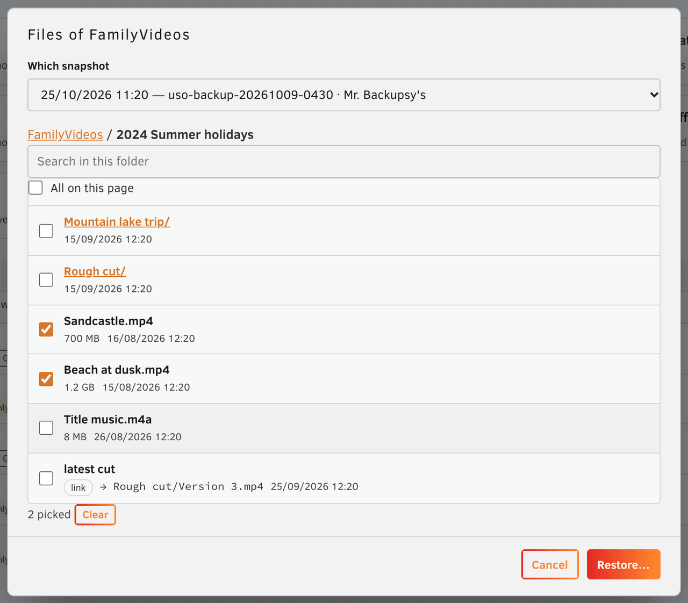</picture></a>

**The flash** has a tile of its own: when its archive was made, how big it is, where it is kept.
*Download…* hands you the archive after a dialog that says what it holds (the licence key, password hashes).

**Kept for <partner>** shows what this server keeps of a partner office. Each app or VM in it can be started here.

<a name="restore-shares"><picture><source media="(prefers-color-scheme: dark)" srcset="https://raw.githubusercontent.com/dropnook/UnraidSecretaryOffice/main/docs/screenshots/restore-shares-dark.png">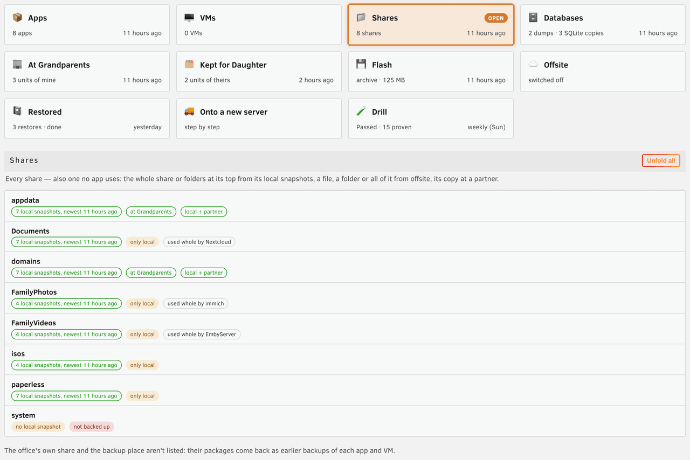</picture></a>

### The restore drill

The drill proves that what Mr. Backupsy keeps really comes back.

- **When:** once a month, or every week on a day you choose, between 00:00 and 07:00, right after a backup that went
  well. Or whenever you press *Practise now…*.
- **What:** he reads every package in full and plays the database dumps into throwaway containers without network.
  He checks the media servers' database copies and the VMs' disks.
- **Offsite:** he streams a sample back (as many GB as you allow) and compares it with the local snapshot.
- **Result:** each app and VM gets a **certificate**: which level is proven, from which copy, when.
- It wakes no disk, never runs during a parity check, ends before the next backup and cleans up after itself.
- What it left unchecked comes first next time.
- The package of an app that is gone is named. *Into the storeroom* on Mr. Backupsy's page puts it away.

<a name="restore-drill"><picture><source media="(prefers-color-scheme: dark)" srcset="https://raw.githubusercontent.com/dropnook/UnraidSecretaryOffice/main/docs/screenshots/restore-drill-dark.png">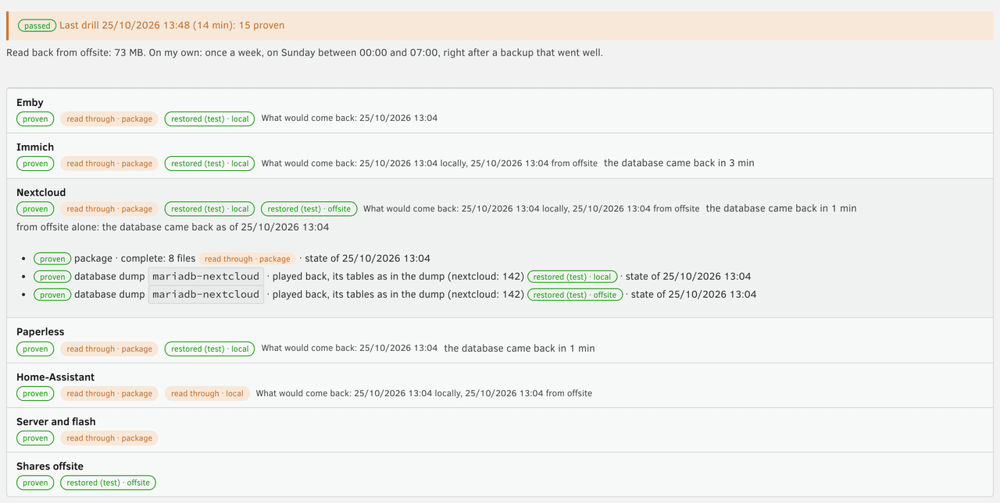</picture></a>

<a name="new-server"></a>
### Onto a new server

When a server is gone or replaced, Mr. Restori's *Onto a new server* lists the steps. Read them while you still can:

1. **Unraid and the licence** — Unraid's own job. From the flash archive take only single pieces
   (a plugin's settings, the go file, User Scripts), never super.dat, the licence key or network.cfg blindly.
2. **Create the shares under the same names first** (*Shares → Add Share*). The office never makes a share.
   Their old settings are in the backup place (`server/shares/`).
3. **Get the backup place back.** Its packages hold the templates, dumps, VM configurations and the flash archive.
   - From a partner: install the office, the Team Lead's *Start from a partner's copy…*, the partner answers with a
     restore ticket. Mr. Restori pulls the backup place first.
   - From offsite: install Kopia with the same *Container Path*, connect it to the same repository (its password from
     your password manager), restore the backup place's share, then install the office.
4. **Then the normal way.** Everything else comes back through Mr. Restori's rows.
5. **What does not come back:** a share or VM with only local snapshots comes back empty. The section names them.

## Partner offices

Two Unraid servers with the office — yours and a friend's or family member's — can keep each other's backups.

**Pairing** at the Team Lead:

1. *Add a partner…* on one server gives a block to paste on the other.
2. *Accept a partner…* there sets the rules once: the pool, a quota, the retention. It answers with a block.
3. *Paste the partner's answer…* on the first server. Both show the same safety code: nobody changed a block.

**Sending:**

- The level **local + partner** per share and VM in Mr. Backupsy's setup says what goes.
- With every backup, their ZFS snapshots go to the partner through SSH. After the first time, only what changed.
- Over a slow path several shares go at once, but only while that makes the copy faster.
- The partner's door takes them up to the quota and keeps them by its own retention. You can't delete them there.
- What really arrived shows as «+ partner» on Mr. Backupsy's page.
- Only ZFS datasets of their own travel. ZFS only, on both sides.
- The partner can read the copies. Kopia to the partner's server is the encrypted way.

**Bringing it back:** Mr. Restori's *At <partner>* pulls a copy into a new dataset beside the original.

**When a server is gone:** the new one asks at its Team Lead (*Start from a partner's copy…*).
The partner answers with a **restore ticket**: a door for seven days that only hands over those copies.

**At the receiver:**

- *Change the quota…* in the pair's ⋯ menu.
- When the partner sends a unit whole again, the door keeps the copy before aside. *Let go…* removes those.

An app's folder that is not a dataset of its own goes only inside its share. *Make it a dataset of its own…* in the
setup changes that.

**The USO network (Tailscale), optional.** Two servers behind different routers need a network that reaches both.

- Any network you have works: your LAN, your VPN, your own Tailscale.
- Or *Join the USO network…* under the partner offices. It takes an auth key from whoever runs the offices' tailnet
  (one-off, tagged `tag:uso`; Tailscale's free plan or your own Headscale).
- The office then runs a Tailscale node of its own, apart from everything else on the server.
  Nothing of your router, your own Tailscale, Unraid's network, DNS or firewall changes.
- Then pair as always. In the network both sides give their USO address by themselves.
- *Change the address…* in the pair's ⋯ menu fixes a wrong address without pairing anew.
- *Leave the USO network…*, or removing the plugin, takes all of it away again.

A partner office, from the network to the copies
([BPMN source](diagrams/partner-pairing.bpmn), [German](diagrams/partner-pairing.de.svg)):

<a name="diagram-partner-pairing">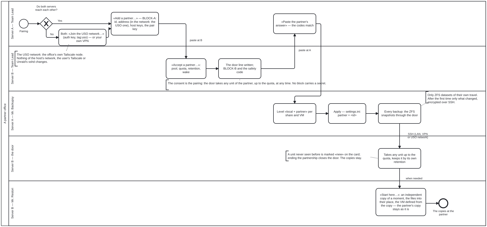</a>

<a name="backup-levels"><picture><source media="(prefers-color-scheme: dark)" srcset="https://raw.githubusercontent.com/dropnook/UnraidSecretaryOffice/main/docs/screenshots/levels-dark.png">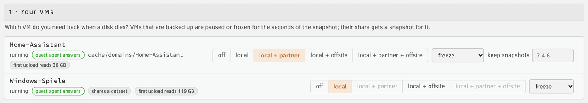</picture></a>

<a name="caretaker-partner"><picture><source media="(prefers-color-scheme: dark)" srcset="https://raw.githubusercontent.com/dropnook/UnraidSecretaryOffice/main/docs/screenshots/partner-dark.png">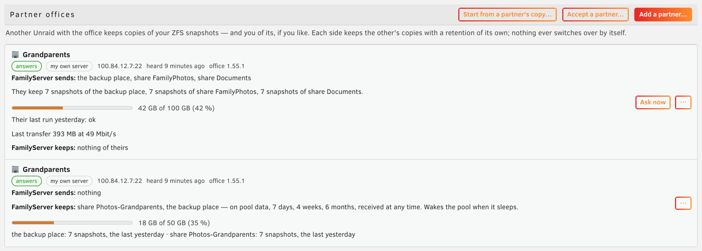</picture></a>

## Jack Streamer and Ms. Moverelli

Together they keep what you watch next on the fast pool and let the array disks sleep.

### Jack Streamer

He looks after helmi1987's MediaCache for Emby, Jellyfin and Plex, several servers at once.

- **What next:** what each person watches next waits on the pool. Watched files go back by the share's settings.
- **Budget:** his *Set up* takes a budget in GB, the hard cap for everything he lays out. At least 20 GB per person.
- **Never while someone watches:** he never gathers files then.
- **Live:** a bar per person shows what is coming and when it will be there. Below it, who is watching what.
- **Copy from every disk at once** (on by default): one copy from each array disk at the same time.
- *Stop after this file* ends a run gently.
- **Gather** (optional): one disk per film folder, so fewer disks wake.
- **theme.mp3 stays on the pool** (*More*, off by default): a title's theme music then never wakes an array disk.
  The first such run reads every title's folder once.
- *Check the structure…* lists films and series that don't lie in a folder of their own. It moves nothing.

**Under Ms. Moverelli's eye:** he is an intern.

- He runs for real only once she is set up and Unraid's own mover schedule is *Disabled*. Until then: dry runs.
- His list of what stays on the pool comes only from a real run. Until then she leaves his shares alone.
- The mover starting during his run stops it after the current file.

<a name="jack-live"><picture><source media="(prefers-color-scheme: dark)" srcset="https://raw.githubusercontent.com/dropnook/UnraidSecretaryOffice/main/docs/screenshots/jack-live-dark.png">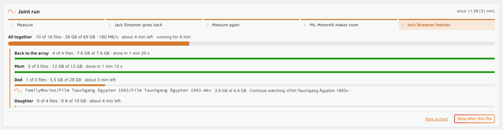</picture></a>

### Ms. Moverelli

She completes Unraid's mover with helmi1987's Smart Mover around **one limit X** for the pool.

- Above X she moves the oldest files of the cache shares to the array or a secondary pool, until the pool sits at X.
  On ZFS the whole pool counts.
- Jack Streamer's GB come first. appdata and the like never move. Episodes not yet watched never go back and forth.
- She leaves out what exclude lists name. Unraid's own move program moves the files; she copies nothing herself.
- She warns when the room is short.

**The joint run** (on her schedule or started by hand): measure, make room, measure again, then Jack Streamer fetches up
to X. Her page draws it live and keeps the last run's picture.

**Unraid's mover:**

- Saving her setup switches Unraid's own mover schedule off, through Unraid's own form. She asks first.
- Letting her go puts it back as it was.
- Mover Tuning must have no schedule of its own. User Scripts and cron lines that call a mover are named, never changed.
- She never runs beside Unraid's mover, one of Jack Streamer's runs or a backup's local part.
- On Unraid 7.4 she shows how far Unraid's own mover is while it runs, with Unraid's *Mover Progress* on.

List, dry run and real run from her page or on her own schedule. She takes over an existing Smart Mover's settings.

<a name="moverelli-live"><picture><source media="(prefers-color-scheme: dark)" srcset="https://raw.githubusercontent.com/dropnook/UnraidSecretaryOffice/main/docs/screenshots/moverelli-live-dark.png">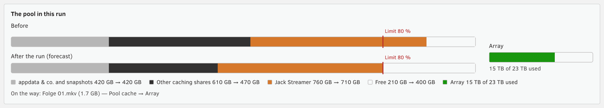</picture></a>

## The other desks

### Ms. Snapshotini

Every ZFS, btrfs and VM snapshot on the server, in one place.

- Create, rename, hold, and delete with an estimate of the space freed.
- Schedules with a simple retention that only ever clears away her own snapshots.
- Her tour never wakes a disk. *Tour, reading them too* reads sleeping disks as well and says whether they woke.
- Entries a deleted VM leaves in Unraid's snapshot list go into the storeroom once nothing of them is left on disk.
- A snapshot ZFS calls «busy»: she says where it hangs. *Free and delete…* unmounts it there and deletes it;
  the container keeps running.

<a name="snapshot-why"><picture><source media="(prefers-color-scheme: dark)" srcset="https://raw.githubusercontent.com/dropnook/UnraidSecretaryOffice/main/docs/screenshots/snapshot-dark.png">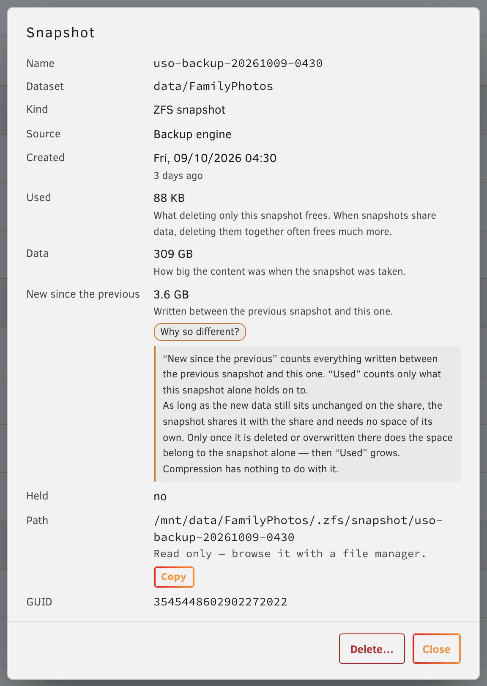</picture></a>

### The Night Watchman's round

He says how securely the server stands and writes down what is different from normal. He changes nothing himself.

When you hire him he learns what is normal. Then he walks his round every five minutes, office open or not.

**What he notes:**

- A login from a new address, a burst of failed logins.
- A container with special rights, a new plugin, a change on the flash, a new cron line, a share open to guests.
- Far more pulled or written than usual, many files deleted at once, snapshots gone that the office didn't remove.
- A job queued for atd that he doesn't know: one line for its lifetime.
  It goes to the notifications once, when it appears.

**How:**

- Each entry names its MITRE ATT&CK technique. The important ones go to Unraid's notifications.
- Where he can't see who did it, he names who likely did, always as a guess.
- *I know, thanks* makes it the new normal.
- *This was a real incident…* keeps it with your note. For 30 days the same from the same source is told at once.
- While the array is stopped, his night shift keeps watch from RAM and the flash.

**The router** (UniFi, MikroTik with RouterOS 7) sends its log to Unraid's syslog server; the Consultant shows how.
He notes new logins, firewall and port-forwarding changes, intrusions, new devices, the log gone silent.
He needs no router password and never talks to the router.

**Why a parity check runs:** each one gets a line with its reason. After an unclean stop the Team Lead says which
time-out to raise. He never starts, pauses or cancels a check.

**What holds the array?** Before you stop the array, his tile says what would hold it up right now:
open files in a share, VMs and their guest agents, containers, mounted snapshots, a *Shutdown time-out* too short.
Read only, no disk wakes up.

<a name="watchman-book"><picture><source media="(prefers-color-scheme: dark)" srcset="https://raw.githubusercontent.com/dropnook/UnraidSecretaryOffice/main/docs/screenshots/watchman-dark.png">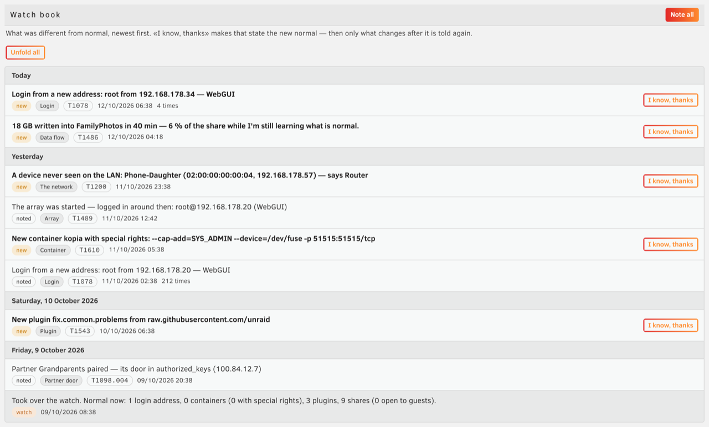</picture></a>

### Ms. Dustdevil

She knows where everything lies and keeps it in order. She never deletes at once.

- **Storage:** how full every pool, disk and share is, with Unraid's thresholds and each one's history.
  Read only, never waking a sleeping disk.
- **The treemap:** the shares by size. A click opens a share: every folder and file as a rectangle by size,
  coloured by kind or by age. It only shows; nothing can be deleted from it.
- **Scans:** the first click on a share scans it. *Scan all…* does every share and asks first when a disk would wake.
- **Clearing away:** unused templates, stacks, appdata folders and Docker's leftovers go into a storeroom first.
  Only images and the build cache, which can be downloaded again, go for good.
- **Logos** for containers without a picture.
- **Schedule:** her tour on its own, off until you set it. What sleeps is left out and named.

<a name="cleanup-storeroom"><picture><source media="(prefers-color-scheme: dark)" srcset="https://raw.githubusercontent.com/dropnook/UnraidSecretaryOffice/main/docs/screenshots/storeroom-dark.png">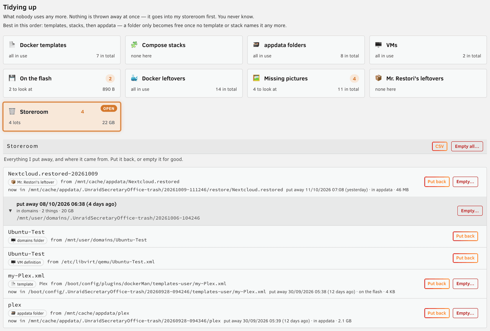</picture></a>

### Ms. Protocolli

She reads every log out loud: Unraid's, the office's, the plugins', every User Script's and container's, the router's.

- **Her tour** counts and groups errors and warnings and watches how full `/var/log` is.
- **Syslog:** Unraid's syslog sorted by the rules from Enhanced Log (disks, network, array, logins …).
  Harmless noise counts neither as an error nor as a warning. *No rule* lists the lines no rule knows.
- **Set up:** rules of your own and texts to hide. A filter can be saved under a name.
- **Who woke my disks?** Every wake of an array or pool HDD, and who was waiting for it: a container, a VM, a computer
  over SMB or NFS, the mover, a task. Per disk how often today and in 7 days. She never wakes a disk.
- **/var/log:** from 80 % she says which file fills it and who writes it. At 90 % she sends one notification.
- **Schedule:** her tour on its own, off until you set it.

### The Consultant

He knows the tools the office relies on and installs them with you, a preview first:
Kopia, Fix Common Problems, Files Viewer, Stream Viewer, unbalanced, Node Exporter, Prometheus, Grafana.

- He sets up the Kopia repository if you like and prints a recovery sheet.
- Guides: ransomware protection with Object Lock, encrypted Kopia to a partner, the router's log into Unraid.

### The search

The magnifier at the top right, or ⌘K / Ctrl+K, finds what you look for and takes you there.

- A desk, a tile, a setting, a step of a setup, a guide — in all five languages, forgiving a typo.
- What the desks know: a share, an app, a VM, a database, an open point, a watch book entry, a partner office.
- It all runs in your browser.

## Install and first steps

You need Unraid **7.3.2 or a newer 7.x**. Nothing else to install.

- Unraid 8 is not supported yet; the plugin refuses to install there.
- Snapshots need ZFS or btrfs. Shares on XFS are backed up without one. Partner offices need ZFS.
- Jack Streamer needs no Python 3.
- Before you update Unraid, look for an office release that names the new version. Unraid switches off a plugin that
  doesn't, and the scheduled backups stop with it. The Team Lead reminds you.

1. *Apps* (Community Applications): search for *secretary* and install. Or *Plugins → Install Plugin* and paste
   ```
   https://github.com/dropnook/UnraidSecretaryOffice/releases/latest/download/unraid-secretary-office.plg
   ```
2. Open **Office** in Unraid's menu bar. The Team Lead welcomes you and suggests whom to hire.
   The office needs the shares *appdata* and *system*. When they are missing it offers to create them.
3. For backups: Mr. Backupsy → *Set up…*.
   - First the backup place, a share of its own. One click has Unraid create `UnraidSecretaryOffice`, or choose yours.
   - Then the rest: he proposes everything with reasons. Change what you like, *Leave out* declines one. Then *Apply*.
   - Then *Schedule…*. The Team Lead lists what is still missing.

**Around the office:**

- *⋯ → Entry in Unraid* renames the menu entry or moves it under *Settings → User Utilities* or to a header button.
- A tile on Unraid's Dashboard shows the messenger, the Team Lead's open points, the last and next backup.
- The green dot beside *⋯*: the messenger (the office's agent) checked in within the last 70 seconds.

<a name="backup-apply"><picture><source media="(prefers-color-scheme: dark)" srcset="https://raw.githubusercontent.com/dropnook/UnraidSecretaryOffice/main/docs/screenshots/backup-setup-dark.png">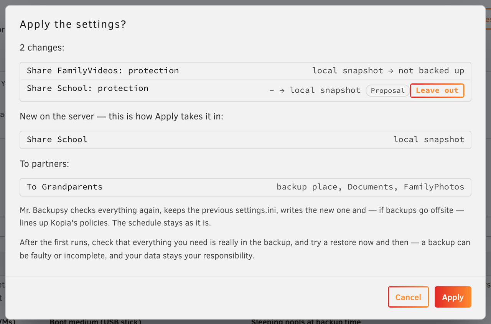</picture></a>

## Updates and removal

**Updating** works like any plugin, under *Plugins*. The Team Lead says when a new version is out.

- While a backup, restore, drill, or Jack Streamer's or Ms. Moverelli's run is going on, the update refuses.
- Your data stays and is brought up to date at the first start. What is rewritten is put aside.
- A page left open offers to reload.

**Removing** (*Plugins → Remove*, refused the same way) takes the code away.

- Your schedules are put aside on the flash and come back when you install the office again.
- Partnerships end; pair again after a new install.
- These stay, delete them yourself if you like: appdata, the share `UnraidSecretaryOffice`, the settings on the flash,
  your snapshots, Ms. Dustdevil's storeroom (the hidden folders `.UnraidSecretaryOffice-trash`).

## What it keeps where

| What | Where |
|---|---|
| Settings, state and logs of every desk, the backup engine's settings | the data folder, `appdata/UnraidSecretaryOffice/data` |
| Mr. Backupsy's packages (templates, compose files, dumps, VM configurations) | the backup place, by default the share `UnraidSecretaryOffice`; their history in its snapshots |
| The plugin package, where the data folder is, the schedules, partner keys, container pictures | the flash, `/boot/config/plugins/unraid-secretary-office/` |
| The code, the messenger's sign of life, snapshots mounted during a run, the numbers for Prometheus | RAM, so a pool of hard disks can sleep |

**Nothing leaves the server** unless you set it up: offsite to your storage, partner offices to the partner.

- The office asks GitHub once a day for a new version and checks logo addresses for containers without a picture.
- It sends a report only when you send one. No telemetry.
- The desks never wake a sleeping disk unless you ask. The scheduled backup does, unless you leave sleeping pools out.

<a name="cleanup-where"><picture><source media="(prefers-color-scheme: dark)" srcset="https://raw.githubusercontent.com/dropnook/UnraidSecretaryOffice/main/docs/screenshots/cleanup-where-dark.png">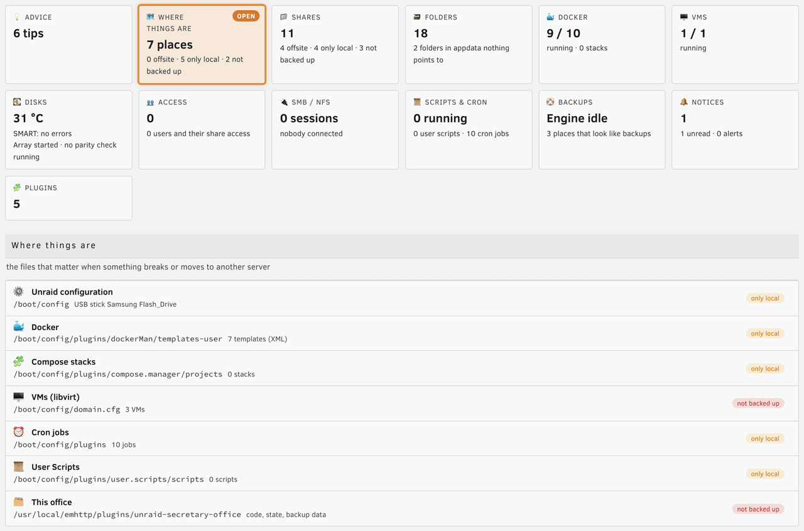</picture></a>

## Languages and themes

The office speaks English, German, Italian, French and Spanish.

- It takes your browser's language; *⋯ → Language* picks another one.
- Where it says what to click in Unraid, Unraid's labels read as Unraid shows them.
- It takes Unraid's theme. *Auto · Dark · Light* and the text size *A · A · A* at the reception change it in your
  browser only.

## Security

Only who is logged in to Unraid gets in. What the office adds are previews and confirmations against mistakes.

- Whoever is logged in to Unraid is root anyway, so there is no PIN. Keep Unraid logged in only where you trust it.
- The page only shows. The messenger does the work on the host, each action checked against a fresh look.
- What is tidied up or replaced is put aside first, never deleted at once.
- Secrets stay put: Kopia's keys go through RAM only, the media servers' API keys never reach the page.
- A partner office gets a door, not a login: a key that can only hand over its copies, fetch them back and ask how
  the office is. No shell, no path, nothing deleted.
- Bringing something back from a partner's copy trusts that partner like your own backup.
  Mr. Restori checks a VM's configuration from a copy and starts nothing. Look at templates from a copy before you
  start them.

What was checked and what is still open: [HARDENING.md](../HARDENING.md).

## Notifications

What needs you while the office is closed goes to Unraid's notifications, as *Unraid Secretary Office*.

- A backup that failed or had warnings. Its first line names them, errors first.
- A drill that couldn't prove a restore, a schedule's problem.
- A new point on the Team Lead's list after half an hour.
- The Night Watchman's new entries, a parity check after an unclean stop.
- The messenger silent for ten minutes.

They come in the language you last used the office in.

**The Team Lead's notification centre** is the one place for the office's own notifications.
Unraid's own and other plugins' stay as they are.

- **Alerts** (something at risk right now) always go out at once.
- **Per colleague:** *Everything*, *Warnings and alerts* or *Alerts only*; successes or not; *right away* or in a
  daily summary at a time you choose.
- *Quiet hours* and *Silent until…* hold everything but alerts and send one summary when they end.
- An optional daily «All quiet» when nothing went out for a day.
- **The flood guard:** the same notification goes out once until it is resolved, or 20 hours later.
  More than 5 from one colleague or 20 from the office in an hour wait for a summary.
- *Send a test notification…* shows where Unraid sends each level. The history keeps 30 days.

## Monitoring

With Node Exporter, Prometheus and Grafana (the Consultant sets them up with you), the office's own numbers go there
too, with a ready Grafana dashboard: [DEVELOPMENT.md](DEVELOPMENT.md#monitoring).
How it works inside, adding a desk or a language, tests and releases: the same document.

## Support

The office is free and complete. Nothing is locked.

- If it is useful to you, a tip is welcome: the Team Lead's *☕ Tips & pay rise* opens the
  [tip page](https://tip.uso.dropnook.app/) with your anonymous USO ID.
- After the tip the office fetches your supporter key by itself (or paste it under *Enter key…*).
- The key unlocks nothing. It stops the reminders and shows a thank-you on the Team Lead's plate:
  ☕ a coffee, ☕☕ a round, 🍰 a cake, 🥂 a pay rise.
- A share goes to helmi1987. What exceeds our costs goes to animal shelters.
- Questions and bugs: the
  [Unraid forum thread](https://forums.unraid.net/topic/201085-plugin-unraid-secretary-office-uso-backups-restore-snapshots-media-cache-for-embyjellyfinplex-smart-mover-security-watch-and-more/),
  [GitHub issues](https://github.com/dropnook/UnraidSecretaryOffice/issues), or from inside the office (below).

## Reporting a problem or a wish

No GitHub account needed: *⋯ → Report a problem or a wish…* on any page.

1. Say what it is (a problem, a wish or a question), which desk, a title and a few words.
2. *Show what will be sent…* lists every part. Names, paths, addresses and keys are cleaned out.
3. Untick what you'd rather keep. Up to three pictures can go along, redrawn without metadata.
4. Nothing leaves the server before you click *Send*.

It goes into the makers' private inbox on GitHub. *Your reports* shows where each one stands. 25 reports a day.

<a name="office-report"><picture><source media="(prefers-color-scheme: dark)" srcset="https://raw.githubusercontent.com/dropnook/UnraidSecretaryOffice/main/docs/screenshots/report-dark.png">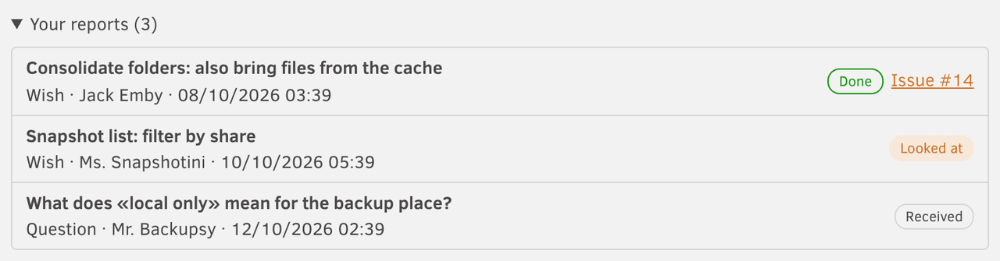</picture></a>

Thanks to **[helmi1987](https://github.com/helmi1987)** for Jack Streamer's MediaCache and folder consolidation
and for Ms. Moverelli's Smart Mover, and to **dlandon** and **Derek Kaser (EDACerton)** for the syslog rules of
Ms. Protocolli from Enhanced Log — see the [README](../README.md#special-thanks).
